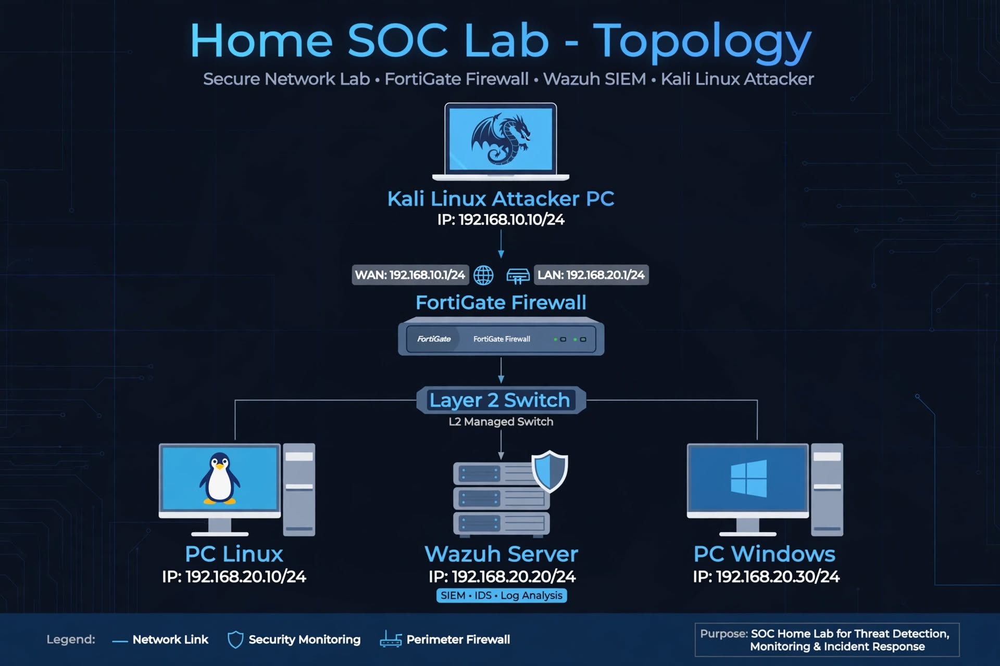

# Cartera de Analista SOC | Daniel Torrico Alvarez

> Home SOC Lab con segmentación real - FortiGate Firewall + Wazuh SIEM + Kali Attacker

## Quién soy
SOC Analyst L1 en formación. Enfocado en Triage, Detección con Wazuh y MITRE ATT&CK.

**Stack:** Wazuh | Windows Event 4625/4624 | FortiGate | Kali Linux | Hydra | VMware

## Topología del Lab

### Versión Profesional

- **Zona Atacante (WAN):** 192.168.10.0/24
- **Zona Interna SOC (LAN):** 192.168.20.0/24

| Equipo | IP | Rol |
|---|---|---|
| Kali Linux | 192.168.10.10 | Atacante - Hydra |
| FortiGate | WAN: 192.168.10.1 / LAN: 192.168.20.1 | Firewall |
| PC Linux | 192.168.20.10 | Víctima |
| PC Windows | 192.168.20.30 | Víctima RDP |
| Servidor Wazuh | 192.168.20.20 | SIEM |

## Laboratorios

### [LAB-01] Ataque Fuerza Bruta RDP con Hydra
**Estado:** Completado - Ver carpeta lab-01-rdp-brute-force/
- Técnica: T1110.001 - Password Guessing
- Herramienta: Hydra con userlist + passlist
- Detección: Wazuh Rule 60122 + Custom Rule 100200
