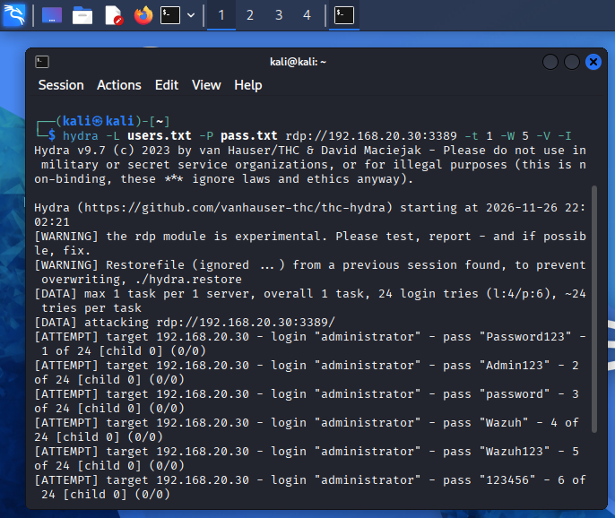
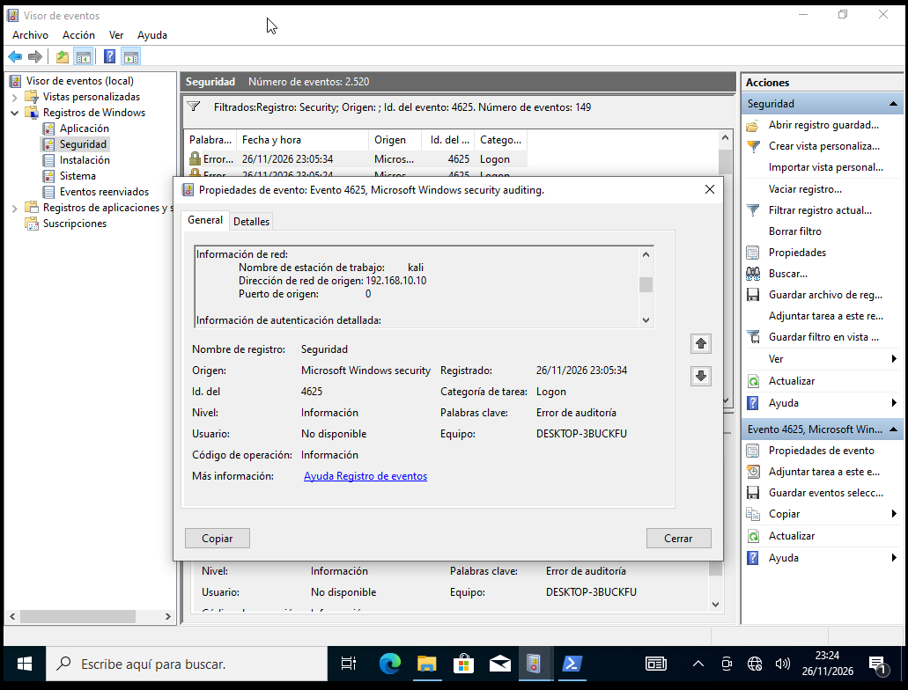
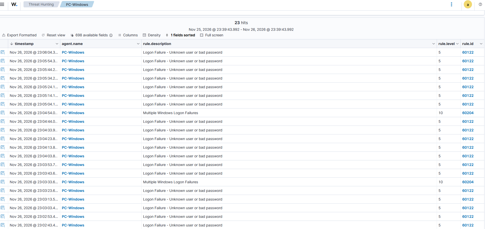
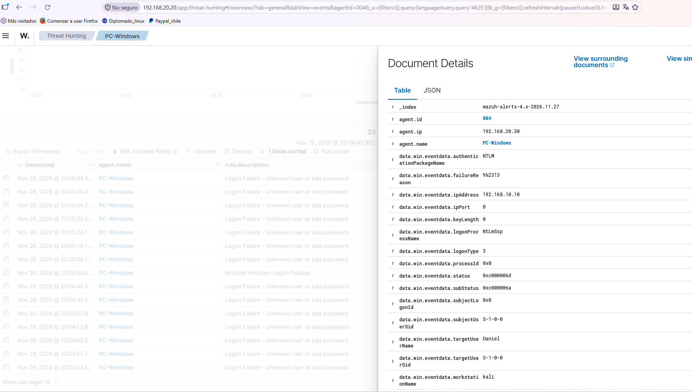
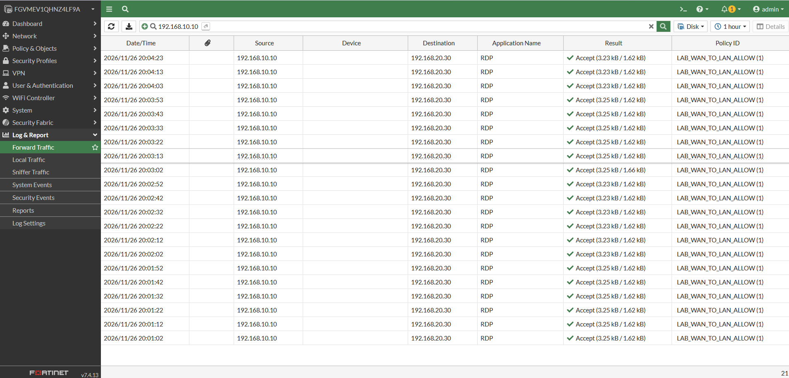

# SOC Analyst L1 Portfolio | Daniel Torrico Alvarez - SecurityX

> Home SOC Lab - FortiGate + Wazuh SIEM + Kali + Windows - Detección y Triage L1

   

## Perfil
**Daniel Torrico Alvarez | SecurityX**
SOC Analyst Nivel 1 | Wazuh | FortiGate | Blue Team | Bolivia

GitHub: github.com/dttorrico-securityX

## Topologia Home Lab

**WAN:** 192.168.10.0/24 - Kali 192.168.10.10 - GW FortiGate 192.168.10.1

**LAN:** 192.168.20.0/24
- Wazuh Server: 192.168.20.20
- PC Linux: 192.168.20.10
- PC Windows: 192.168.20.30:3389 RDP
- FortiGate LAN: 192.168.20.1

**Policy:** LAB_WAN_TO_LAN_ALLOW (1) - 232 hits / 972KB - Log All Sessions

---

## LAB-01 - RDP Brute Force - MITRE T1110.001

**Estado:** Completado con evidencias reales - 2026-11-26

**Ataque:**
- Herramienta: Hydra 9.7
- Comando: `hydra -L users.txt -P pass.txt rdp://192.168.20.30:3389 -t 1 -V -I`
- Origen: Kali 192.168.10.10
- Destino: Windows 192.168.20.30:3389
- Intentos: 24 logins

**Deteccion:**

| Fuente | Evento | Evidencia |
|--------|--------|-----------|
| Windows | Event ID 4625 | 149 eventos 23:05-23:06 - Src IP 192.168.10.10 |
| Wazuh | Rule 60122 | 23 hits - PC-Windows (004) - level 5 |
| Wazuh | Rule 60204 / 100200 | 8 fails en 120s - same IP - level 10 |
| FortiGate | Forward Traffic | 192.168.10.10 -> 192.168.20.30:3389 Accept - Policy 1 - 21 logs |

**Evidencias (6 capturas reales):**
- [Ver carpeta screenshots](./lab-01-rdp-brute-force/screenshots/)

**Triage L1:**
- Clasificacion: True Positive
- Severidad: Media (5-10)
- Accion: Bloqueo IP 192.168.10.10 en FortiGate, revision cuentas
- Hardening: Cambiar puerto RDP, NLA, limitar intentos, MFA
- Regla: 100200 - 8 fails en 120s -> Alerta nivel 10

---

## Proximos Labs
- LAB-02: SSH Brute Force - T1110.001 - Kali -> Linux 192.168.20.10:22
- LAB-03: Wazuh Active Response

## Stack
Wazuh Server 192.168.20.20 | FortiGate | Kali 192.168.10.10 | Hydra | Windows 192.168.20.30 | MITRE ATT&CK
