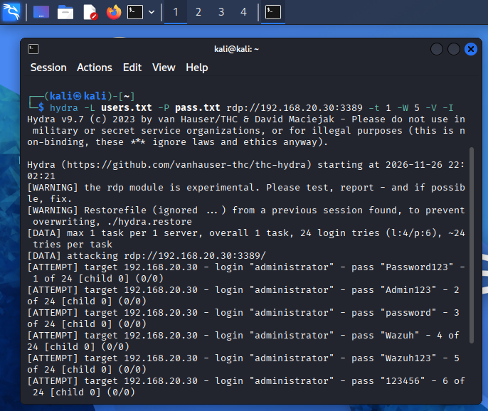
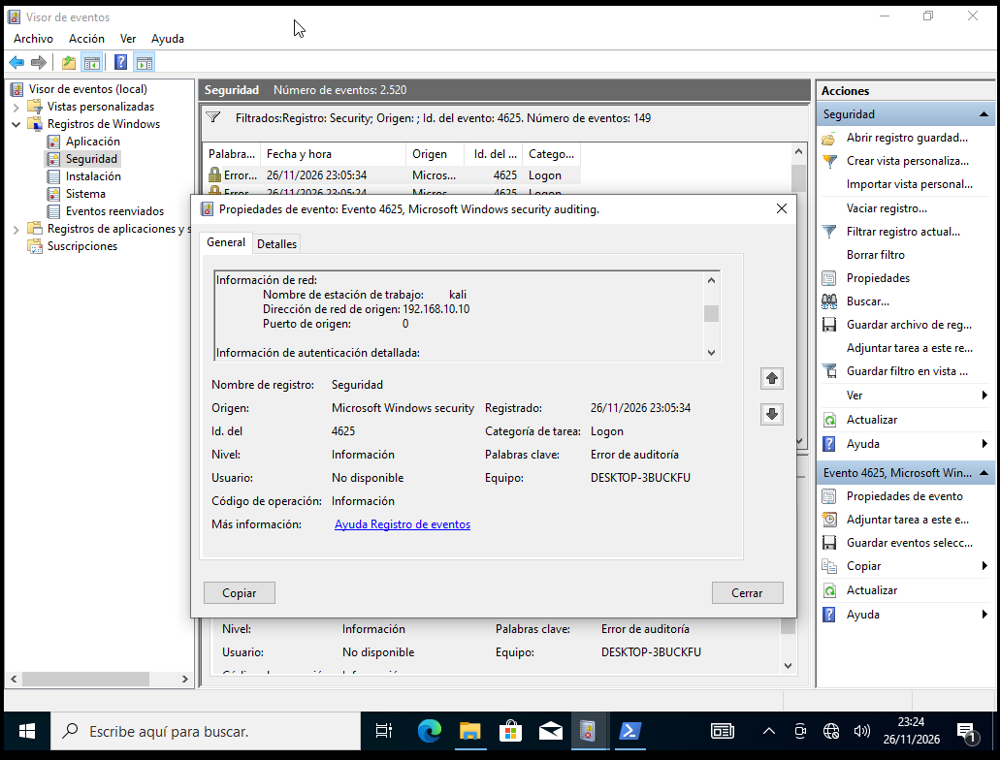
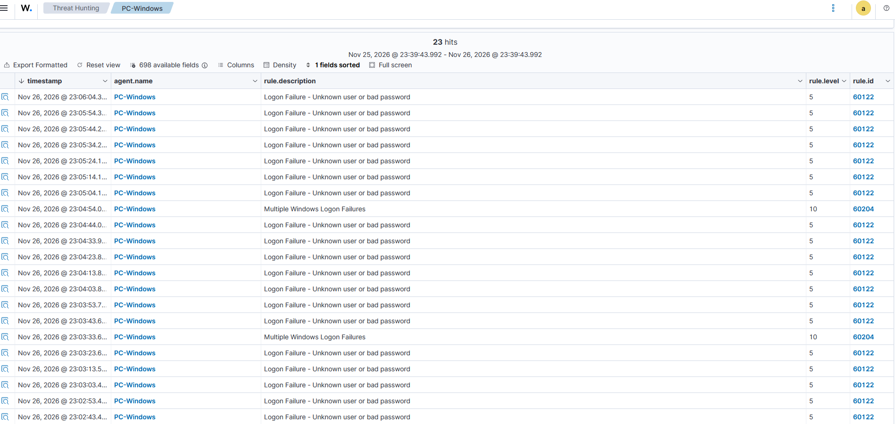
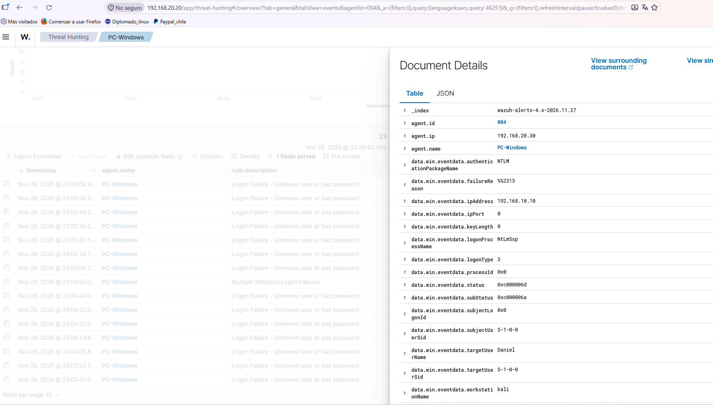
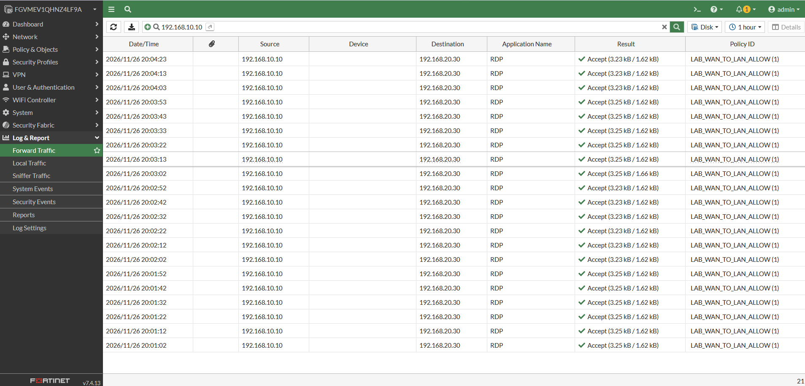

# Evidencias LAB-01 - RDP Fuerza Bruta - MITRE T1110.001

Cadena de ataque completa: Kali 192.168.10.10 -> FortiGate -> Windows 192.168.20.30 -> Wazuh

## 1. Ataque en Kali - Hydra RDP
**Comando:** `hydra -L usuarios.txt -P contraseñas.txt rdp://192.168.20.30 -V -f`

## 2. Registros en Windows - Event ID 4625
**Ruta:** Visor de eventos > Seguridad > ID 4625 | 149 eventos generados 23:05-23:06

Detalle PowerShell:

## 3. Alerta en Wazuh - Detección 60122 / 60204
**Ruta:** Panel de Wazuh > Threat Hunting > Eventos 4625 desde 192.168.10.10

**Detalle IP Atacante:**
`data.win.eventdata.ipAddress: 192.168.10.10` | `targetUserName: Daniel` | `logonType: 3`

## 4. Tráfico en FortiGate - Forward Traffic RDP
**Ruta:** FortiGate > Log & Report > Forward Traffic | Policy LAB_WAN_TO_LAN_ALLOW (1)
`Source 192.168.10.10 -> Destination 192.168.20.30:3389 | Result: Accept RDP`

---
**Conclusión L1:** True Positive - RDP Brute Force T1110.001 detectado. Acción: Bloqueo IP 192.168.10.10 en FortiGate, harden RDP, revisión regla custom 100200 (8 fails en 120s)
